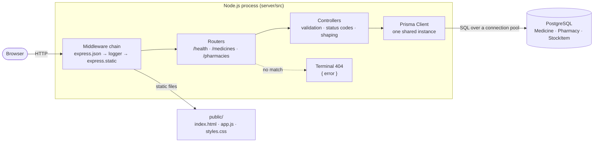
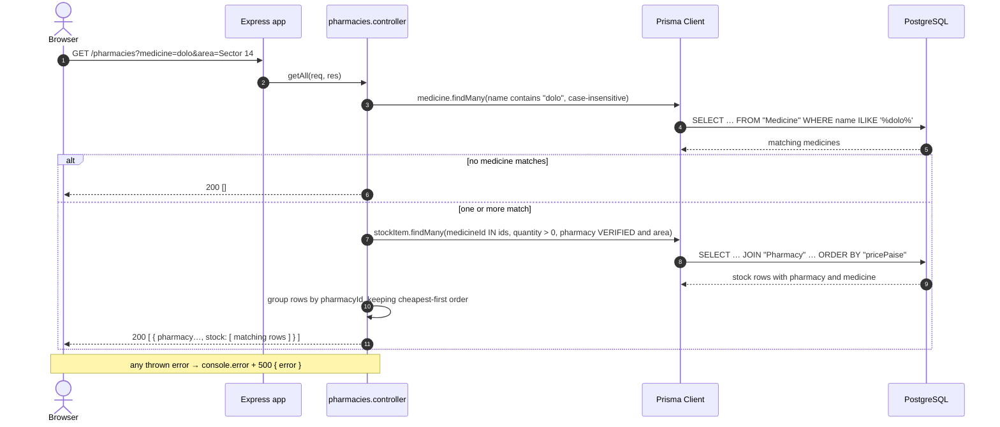
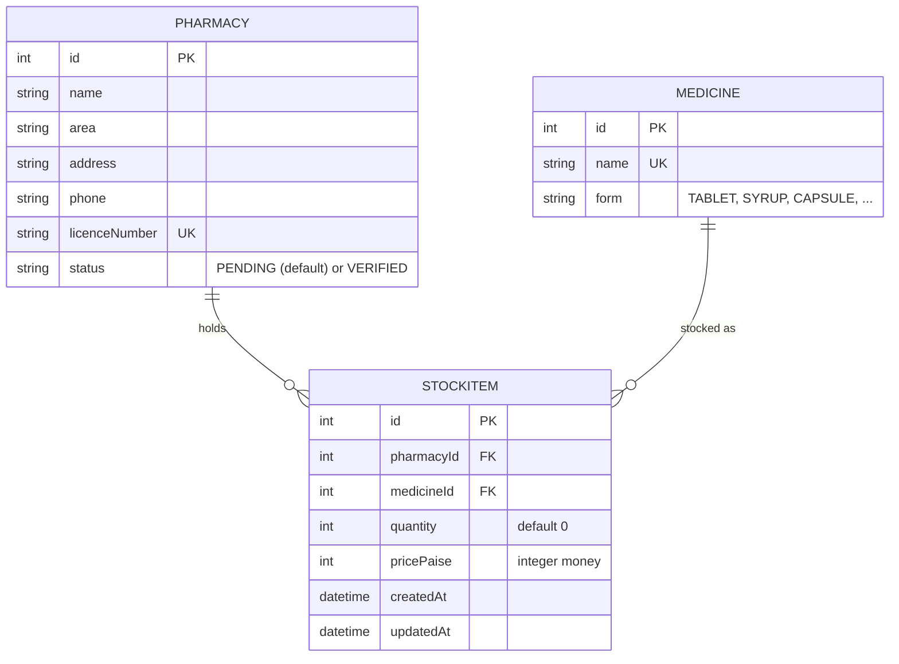

<div align="center">

# Velora

**Emergency medicine discovery: find a verified pharmacy that has your medicine in stock, right now.**


[Overview](#overview) · [Architecture](#architecture) · [Data model](#data-model) · [API reference](#api-reference) · [Getting started](#getting-started) · [Engineering decisions](#engineering-decisions) · [Tracker](https://velora-capstone.pages.dev/tracker/)

</div>

---

## Overview

When someone needs a medicine urgently, typically late at night, in an unfamiliar area or for a prescription that is hard to find, the usual approach is to phone or visit pharmacies one at a time. Velora replaces that with one search: type a medicine name and get back only **verified** pharmacies that currently hold it **with stock above zero**, each listed with the matching items, quantities and prices.

Velora is the CSA213 Advanced Programming capstone at Rishihood University. It is a REST API built with **Node.js, Express 5, Prisma ORM and PostgreSQL**, plus a static client served by the same process. The scope is deliberately bounded by the course lectures (L1–L12), so the system shows a small, complete and well-tested core rather than a broad one.

| Capability | Status |
| --- | --- |
| Express API skeleton: JSON parser, request logger, health check, terminal JSON 404 | Done (P1) |
| Fail-fast environment configuration | Done (P1) |
| Static search client with loading / empty / error / data states | Done (P1) |
| Relational schema and versioned migration (`Medicine`, `Pharmacy`, `StockItem`) | Done (P2) |
| Idempotent development seed from JSON fixtures | Done (P2) |
| Medicines resource: list, case-insensitive filter, detail, development-only writes | Done (P2) |
| Pharmacies resource: medicine search, area filter, detail with nested stock | Done (P2) |
| Stock resource: list by pharmacy, add, update, delete | Planned (P3, commit 16) |
| Contract sweep over every route, viva script and report | Planned (P3, commits 19–20) |

---

## Architecture

Velora is a single Node.js process using a layered **router → controller → ORM** design. There is no service layer: each controller owns its Prisma calls, which keeps every request path short enough to read in one file.



### Middleware order

The order in `server/src/app.js` matters, and each stage has one job:

| # | Stage | Responsibility |
| --- | --- | --- |
| 1 | `express.json()` | Parses JSON request bodies into `req.body` |
| 2 | `logger` | Prints one line per request: `METHOD url` |
| 3 | `express.static('public')` | Serves the search client; non-file paths fall through |
| 4 | `/health`, `/medicines`, `/pharmacies` | Resource routers, one per file |
| 5 | Terminal 404 | Sends `{ "error": "Route not found" }` and never calls `next()` |

### Request lifecycle: medicine search



---

## Data model

Three tables. `StockItem` is the join entity that resolves the many-to-many relation between pharmacies and medicines and carries the attributes of that relation: quantity and price.



| Rule | Where it is enforced |
| --- | --- |
| Medicine names are unique | `@unique` → index `Medicine_name_key`; checked first in JavaScript so a duplicate returns `400` |
| Licence numbers are unique | `@unique` → index `Pharmacy_licenceNumber_key`; checked first in JavaScript |
| A stock row must reference a real pharmacy and medicine | Foreign keys with `ON DELETE RESTRICT ON UPDATE CASCADE` |
| A medicine that is still stocked cannot be deleted | Checked first in JavaScript (`400`) before the foreign key would raise |
| New pharmacies start unverified | Column default `'PENDING'`; the API ignores any `status` in the request body |
| Money never uses floating point | Prices are stored as integer **paise**; the client formats `₹` |

The schema lives in [`server/prisma/schema.prisma`](server/prisma/schema.prisma). The generated SQL is committed under [`server/prisma/migrations/`](server/prisma/migrations/), so every environment builds the identical structure.

---

## API reference

**Base URL:** `http://localhost:3000`

### Response contract

| Outcome | Status | Body |
| --- | --- | --- |
| Read succeeded | `200` | The bare resource (an object or an array; no wrapper) |
| Resource created | `201` | The created row |
| Resource deleted | `204` | Empty |
| Invalid input (bad id, missing field, duplicate, blocked delete) | `400` | `{ "error": "…" }` |
| Unknown id or route | `404` | `{ "error": "…" }` |
| Unexpected failure (logged server-side) | `500` | `{ "error": "…" }`, never a stack trace |

No other status codes are used.

### Endpoints

| Method | Path | Description | Codes |
| --- | --- | --- | --- |
| `GET` | `/health` | Liveness probe → `{ "ok": true }` | 200 |
| `GET` | `/medicines` | All medicines, sorted by name | 200 |
| `GET` | `/medicines?name=` | Case-insensitive substring filter | 200 |
| `GET` | `/medicines/:id` | One medicine | 200, 400, 404 |
| `POST` | `/medicines` | Create `{ name, form }` · *development only* | 201, 400 |
| `PUT` | `/medicines/:id` | Replace `name` and `form` · *development only* | 200, 400, 404 |
| `DELETE` | `/medicines/:id` | Delete; refused while stocked · *development only* | 204, 400, 404 |
| `GET` | `/pharmacies` | Verified pharmacies with full stock and medicine | 200 |
| `GET` | `/pharmacies?area=` | Same, filtered by area (case-insensitive exact match) | 200 |
| `GET` | `/pharmacies?medicine=` | Search: verified pharmacies with a matching in-stock item | 200 |
| `GET` | `/pharmacies?medicine=&area=` | Search narrowed to one area | 200 |
| `GET` | `/pharmacies/:id` | One pharmacy with all its stock and each medicine | 200, 400, 404 |
| `POST` | `/pharmacies` | Create; the server sets `status` · *development only* | 201, 400 |

> **Development-only writes.** Write routes are registered only when `NODE_ENV` is not `production`. In production those paths fall through to the terminal 404, so an unauthenticated build cannot change data.

### Examples

<details>
<summary><code>GET /pharmacies?medicine=dolo</code> (the search the client runs)</summary>

```http
GET /pharmacies?medicine=dolo HTTP/1.1
Host: localhost:3000
```

```json
[
  {
    "id": 2,
    "name": "City Care Pharmacy",
    "area": "Sector 14",
    "address": "SCO 22, Sector 14 Market, Sonipat",
    "phone": "9000000102",
    "licenceNumber": "HR-SNP-DEMO-0102",
    "status": "VERIFIED",
    "stock": [
      {
        "id": 6,
        "pharmacyId": 2,
        "medicineId": 1,
        "quantity": 15,
        "pricePaise": 3100,
        "createdAt": "2026-11-11T16:20:41.512Z",
        "updatedAt": "2026-11-11T16:20:41.512Z",
        "medicine": { "id": 1, "name": "Dolo 650", "form": "TABLET" }
      }
    ]
  }
]
```

Each pharmacy carries **only** the stock rows that matched the search. A `PENDING` pharmacy, or a row with `quantity: 0`, never appears. Results are ordered by the price of the cheapest matching item.
</details>

<details>
<summary><code>GET /medicines/abc</code> and <code>GET /medicines/999</code> (error envelope)</summary>

```http
HTTP/1.1 400 Bad Request
{ "error": "Invalid medicine id" }
```

```http
HTTP/1.1 404 Not Found
{ "error": "Medicine not found" }
```
</details>

<details>
<summary><code>POST /pharmacies</code> (the server owns <code>status</code>)</summary>

```bash
curl -X POST http://localhost:3000/pharmacies \
  -H 'Content-Type: application/json' \
  -d '{"name":"Test Chemist","area":"Rai","address":"Rai, Sonipat",
       "phone":"9000000199","licenceNumber":"HR-SNP-TEST-0199","status":"VERIFIED"}'
```

```json
{ "id": 7, "name": "Test Chemist", "area": "Rai", "status": "PENDING", "…": "…" }
```

The `status` in the body is ignored, so a client cannot verify itself.
</details>

---

## Getting started

### Prerequisites

| Tool | Version |
| --- | --- |
| Node.js | 18 or newer (developed on 22 LTS) |
| npm | bundled with Node.js |
| PostgreSQL | 12 or newer, running locally |

### 1 · Install

```bash
git clone https://github.com/vishalkbladerunner-create/velora_AP_2026.git
cd velora_AP_2026/server
npm install
```

### 2 · Configure

There is no `dotenv`. The API reads `process.env` once at start-up, through `src/config/env.js`, and **fails fast** if a required key is missing. Prisma's CLI reads `server/.env`; the running server reads the shell.

```bash
cp .env.example .env            # then put your own credentials in DATABASE_URL
set -a; source .env; set +a     # export the same values into this shell
```

| Variable | Required | Default | Used by |
| --- | --- | --- | --- |
| `DATABASE_URL` | yes | none | API config, Prisma |
| `PORT` | no | `3000` | API |
| `NODE_ENV` | no | `development` | API; `production` disables write routes |

A missing key stops boot with one line: `Missing environment variables: DATABASE_URL`.

### 3 · Create the schema and seed it

```bash
npx prisma migrate dev          # creates the database if needed and applies migrations
node prisma/dev-seed.js         # 12 medicines, 6 pharmacies, 20 stock rows
```

### 4 · Run

```bash
npm run dev                     # nodemon, restarts on save
npm start                       # plain node
```

Open **http://localhost:3000** and search for `dolo`, or call the API directly:

```bash
curl http://localhost:3000/health
curl "http://localhost:3000/pharmacies?medicine=dolo&area=sector%2014"
```

---

## Development seed

[`server/prisma/dev-seed.js`](server/prisma/dev-seed.js) fills a local database from JSON fixtures in [`server/prisma/data/`](server/prisma/data/). It is **development-only** and **idempotent**.

| Property | Implementation |
| --- | --- |
| Asynchronous file I/O | `fs.promises.readFile` + `JSON.parse` per fixture |
| Re-runnable | Every row is looked up first and created only when absent; a second run creates nothing |
| Id-independent fixtures | Stock rows reference a pharmacy by `licenceNumber` and a medicine by `name`, never by auto-increment id |
| Selective runs | `process.argv` picks `all` (default), `medicines`, `pharmacies` or `stock` |
| Safe ordering | Seeding stock before its parents fails with a clear message and exit code `1` |
| Observable | Prints created / existing counts per table and the final totals |

```bash
node prisma/dev-seed.js            # everything
node prisma/dev-seed.js stock      # one table
```

The fixtures model a realistic case in Sonipat, Haryana: four verified pharmacies, two pending ones, and deliberate edge cases (zero-quantity rows, and a pending pharmacy holding stock) so that the search filters are visible in the results.

---

## Project structure

```text
.
├── course-demos/              Standalone programs that prove the lectures the API does not exercise
│   ├── http/                  L5–L6  raw http server: manual routing, status codes, Buffer body
│   ├── fs/                    L2–L4  modules, sync vs callback vs promise reads, streaming a 5,000-row CSV
│   ├── event-loop/            L2     blocking pbkdf2Sync vs thread-pool pbkdf2, measured
│   └── express/               L7     all five HTTP methods, params, query, JSON errors
├── docs/
│   ├── api-checks.md          Recorded manual API checks (expected vs actual)
│   └── *.html                 Architecture and flowchart posters
├── server/
│   ├── prisma/
│   │   ├── schema.prisma      Data model (source of truth)
│   │   ├── migrations/        Versioned SQL, committed
│   │   ├── data/              Seed fixtures (JSON)
│   │   └── dev-seed.js        Idempotent development seed
│   ├── public/                Static client: index.html · app.js · styles.css
│   └── src/
│       ├── config/env.js      Read the environment once, fail fast
│       ├── db/prisma.js       One shared PrismaClient (one connection pool)
│       ├── middlewares/       Request logger
│       ├── routes/            One router per resource
│       ├── controllers/       Validation, Prisma calls, status codes
│       ├── utils/             AppError, asyncHandler
│       ├── app.js             Middleware order and mounting
│       └── server.js          Entry point: listen on config.port
└── README.md
```

---

## Engineering decisions

| Decision | Rationale |
| --- | --- |
| **Express 5, CommonJS, no build step** | The syllabus stack; `node --check` and `npm run dev` are the whole toolchain. |
| **One shared `PrismaClient`** | Every module imports `src/db/prisma.js`, so the process holds a single connection pool instead of one per file. |
| **Validation in plain JavaScript, not the schema** | No enums, compound uniques or `@@index`: rules stay readable in the controller and map directly to a `400` with a precise message. |
| **Check-then-create over `upsert` / `createMany`** | Uses only taught Prisma calls, makes the seed's idempotency explicit, and turns uniqueness violations into `400`s instead of database errors. |
| **Integer paise for money** | Avoids floating-point rounding on prices; formatting happens only at the edge (the client). |
| **Server-owned `status`** | Verification can never come from the request body; new pharmacies are always `PENDING`. |
| **Search returns only matching stock** | The client renders exactly what is relevant, and out-of-stock or unverified results cannot leak into a search. |
| **Writes gated by `NODE_ENV`** | Without authentication, write routes must not exist in a public deployment. |
| **Uniform response contract** | Bare resource on success, `{ error }` on failure, six status codes only, which keeps the client's error handling trivial. |
| **Fail-fast configuration** | A misconfigured environment stops at boot with one clear message instead of failing on the first query. |

---

## Verification

Every endpoint is exercised with `curl` against a seeded database, and the results are recorded in [`docs/api-checks.md`](docs/api-checks.md) as *request → expected → actual*. Each commit's Definition of Done requires:

- `node --check` passes on every new file, and `npm run dev` boots;
- every acceptance check in the commit's playbook passes and is recorded;
- responses follow the contract above (status codes 200, 201, 204, 400, 404 and 500 only);
- no secrets are committed, and `.env.example` is kept current;
- the commit is read by a ring partner before it lands.

| Suite | Owner | Covers | Result |
| --- | --- | --- | --- |
| t1 · Medicines read | Manav | list, filter, 400 / 404, create / replace / delete | 10 / 10 pass |
| t2 · Pharmacies read | Manav | verified-only list, area, medicine search, detail, server-owned status | 11 / 11 pass |
| t3 · Stock write | Sayem | planned with commit 16 | none yet |
| t4 · Envelope and codes | Yash | planned with commit 19 | none yet |

---

## Course demos

The API cannot naturally show every lecture, so four small, independent programs do. Each has its own README with run instructions and expected output.

| Demo | Run | Lecture | Demonstrates |
| --- | --- | --- | --- |
| Raw HTTP | `node course-demos/http/server.js` (port 3001) | L5–L6 | `http.createServer`, manual routing, headers and status codes, POST body via `Buffer` |
| Files and streams | `node course-demos/fs/index.js` | L2–L4 | user modules; `readFileSync` vs callback vs promise; streaming a 5,000-row CSV; `.pipe()` |
| Event loop | `node course-demos/event-loop/index.js` | L2 | blocking `pbkdf2Sync` vs pooled `pbkdf2`; libuv's 4-thread pool; `UV_THREADPOOL_SIZE` |
| Express routing | `node course-demos/express/server.js` (port 3002) | L7 | GET / POST / PUT / PATCH / DELETE, route params, query filters, JSON error envelope |

---

## Scope and non-goals

The lectures stop at Express, routers, PostgreSQL and Prisma, so the following are **intentionally out of scope** and documented as such in the report: accounts and authentication, roles and an admin verification workflow, reservations or holds, MongoDB, a React client, geolocation and distance sorting, and cloud deployment.

---

## Team and workflow

| Member | Ownership |
| --- | --- |
| **Vishal** | Toolchain, Express skeleton, configuration, static client, README *(repository owner)* |
| **Manav** | Prisma schema and migration, development seed, Medicines and Pharmacies APIs |
| **Yash** | Error utilities and the course demos (http, fs, event loop, Express routing) |
| **Sayem** | Stock API, `pg` driver demo, client wiring, contract sweep, viva script and report |

- **Branches:** `feat/<n>-<slug>`, `chore/<n>-<slug>`, `docs/<n>-<slug>`, one per tracked commit.
- **Commit format:** a conventional subject, then lecture tags, files and phase:

  ```text
  feat(server): pharmacies API: medicine and area filters, detail with stock

  Lectures: L9 L12
  Files:    server/src/routes/pharmacies.router.js · controllers/pharmacies.controller.js
  Phase:    P2 (commit #15)
  ```

- **Review:** every commit is read by a ring partner before it is merged.
- **Plan:** 20 commits across three phases, tracked live at **[velora-capstone.pages.dev/tracker](https://velora-capstone.pages.dev/tracker/)**.

---

<div align="center">
<sub>CSA213 Advanced Programming · Rishihood University · 2026</sub>
</div>
