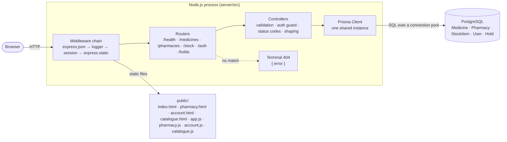
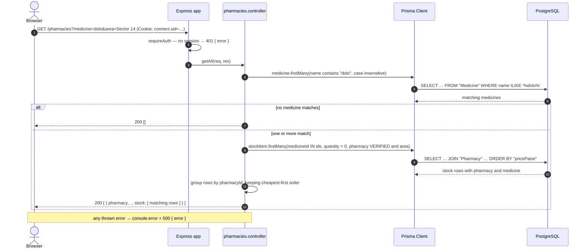
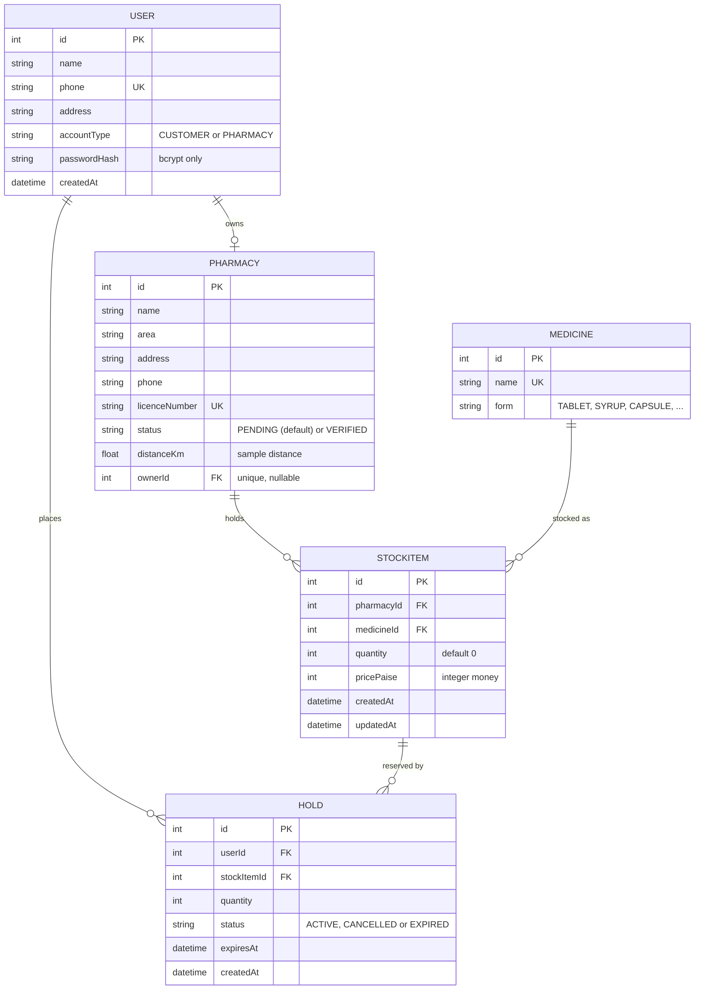

<div align="center">

# Velora

**Emergency medicine discovery: find a verified pharmacy that has your medicine in stock, right now.**


[Overview](#overview) · [Architecture](#architecture) · [Data model](#data-model) · [API reference](#api-reference) · [Getting started](#getting-started) · [Engineering decisions](#engineering-decisions) · [Tracker](https://velora-capstone.pages.dev/tracker/)

</div>

---

## Overview

When someone needs a medicine urgently, typically late at night, in an unfamiliar area or for a prescription that is hard to find, the usual approach is to phone or visit pharmacies one at a time. Velora replaces that with one search: type a medicine name and get back only **verified** pharmacies that currently hold it **with stock above zero**, each listed with the matching items, quantities and prices.

Velora is the CSA213 Advanced Programming capstone at Rishihood University. It is a REST API built with **Node.js, Express 5, Prisma ORM and PostgreSQL**, plus a static client served by the same process. The scope stays within the course lectures (L1–L12) except for one approved exception: accounts, 30-minute stock holds and the role gates that protect them, recorded in `AGENTS.md`. Everything else remains a small, complete and manually verified core rather than a broad one.

Two account types share the same system. A **customer** searches, reserves stock and keeps a profile. A **pharmacy owner** also registers one pharmacy and maintains the shared medicine catalogue and that pharmacy’s stock. The type is stored on the account and checked by the API, so the interface is not what keeps the two apart.

| Capability | Status |
| --- | --- |
| Express API skeleton: JSON parser, request logger, health check, terminal JSON 404 | Done (P1) |
| Fail-fast environment configuration | Done (P1) |
| Static search client with loading / empty / error / data states | Done (P1) |
| Relational schema and versioned migration (`Medicine`, `Pharmacy`, `StockItem`) | Done (P2) |
| Idempotent development seed from JSON fixtures | Done (P2) |
| Medicines resource: list, case-insensitive filter, detail, development-only writes | Done (P2) |
| Pharmacies resource: medicine search, area filter, detail with nested stock | Done (P2) |
| Stock resource: list by pharmacy, add, update, delete | Done (P3) |
| PostgreSQL direct pg driver demo and pool verification | Done (P3) |
| Search client linked to pharmacy detail page with stock table | Done (P3) |
| Patient accounts: register, login, logout, session cookie | Done (approved exception) |
| 30-minute stock holds: reserve, list, cancel, expiry restore | Done (approved exception) |
| Pharmacy registration at account creation; one pharmacy per account | Done (development tool) |
| Development catalogue page: add, edit and delete medicines; manage your own pharmacy's stock | Done (development tool) |
| Typed accounts: customer and pharmacy owner, enforced by middleware | Done (approved exception) |
| Profile editing: name, mobile number and address | Done |
| Pharmacy details editing: name, area, address and phone | Done |
| Seeded distance on each pharmacy, shown beside search results | Done (sample data) |
| Contract sweep over every route, README and report | Done (P3) |

---

## Architecture

Velora is a single Node.js process using a layered **router → controller → ORM** design. There is no service layer: each controller owns its Prisma calls, which keeps every request path short enough to read in one file.



### Middleware order

The order in `server/src/app.js` matters, and each stage has one job:

| # | Stage | Responsibility |
| --- | --- | --- |
| 1 | `express.json()` | Parses JSON request bodies into `req.body` |
| 2 | `logger` | Prints one line per request: `METHOD url` |
| 3 | `express.static('public')` | Serves the search client and detail page; non-file paths fall through |
| 4 | `/health`, `/medicines`, `/pharmacies`, `/stock` | Resource routers, one per file |
| 5 | Terminal 404 | Sends `{ "error": "Route not found" }` and never calls `next()` |

### Request lifecycle: medicine search



---

## Data model

Five tables. `StockItem` is the join entity that resolves the many-to-many relation between pharmacies and medicines and carries the attributes of that relation: quantity and price. `Hold` reserves part of one stock row for one user for 30 minutes.



| Rule | Where it is enforced |
| --- | --- |
| Medicine names are unique | `@unique` → index `Medicine_name_key`; checked first in JavaScript so a duplicate returns `400` |
| Licence numbers are unique | `@unique` → index `Pharmacy_licenceNumber_key`; checked first in JavaScript |
| One stock row per pharmacy–medicine pair | `@@unique([pharmacyId, medicineId])` → index `StockItem_pharmacyId_medicineId_key` |
| A stock row must reference a real pharmacy and medicine | Foreign keys with `ON DELETE RESTRICT ON UPDATE CASCADE` |
| A medicine that is still stocked cannot be deleted | Checked first in JavaScript (`400`) before the foreign key would raise |
| New pharmacies start unverified | The public create route sets `PENDING`. Account registration sets `PENDING` in production and `VERIFIED` in this development build. |
| Money never uses floating point | Prices are stored as integer **paise**; the client formats `₹` |
| One account per mobile number | `User.phone` is `@unique`; the password is stored only as a bcrypt hash |
| One pharmacy per account | `Pharmacy.ownerId` is `@unique` and nullable; seeded pharmacies have no owner |
| Only the owner changes stock | `POST`/`PUT`/`DELETE /stock` compare the session user with `Pharmacy.ownerId` and return `403` for anyone else |
| A hold belongs to one user and one stock row | Foreign keys on `Hold`; the owner is checked before a cancel |
| A hold never overdraws stock | `$transaction` + `updateMany` checks `quantity >= requested` before the decrement |
| Expired stock returns to the shelf | The next hold request marks due holds `EXPIRED` and increments the stock row once |
| Accounts are typed | `User.accountType` is `CUSTOMER` or `PHARMACY`; the server sets it at registration, and pharmacy-only routes return `403` for a customer |
| Every account stores an address | Required at registration and editable through `PUT /auth/me` |
| Only the owner edits the pharmacy | `PUT /pharmacies/mine` changes name, area, address and phone; the licence number and verified status stay server-owned |
| Distance is stored, not calculated | `Pharmacy.distanceKm` holds a sample distance per pharmacy; it labels results but is not a GPS or haversine measurement |

The schema lives in [`server/prisma/schema.prisma`](server/prisma/schema.prisma). The generated SQL is committed under [`server/prisma/migrations/`](server/prisma/migrations/), so every environment builds the identical structure.

---

## API reference

**Base URL:** `http://localhost:3000`

### Response contract

| Outcome | Status | Body |
| --- | --- | --- |
| Read succeeded | `200` | The bare resource (an object or an array; no wrapper) |
| Resource created | `201` | The created row |
| Resource deleted | `204` | Empty |
| Invalid input (bad id, missing field, duplicate, blocked delete) | `400` | `{ "error": "…" }` |
| Missing or invalid session | `401` | `{ "error": "Authentication required" }` |
| Wrong role or another user's record | `403` | `{ "error": "…" }` |
| Unknown id or route | `404` | `{ "error": "…" }` |
| Unexpected failure (logged server-side) | `500` | `{ "error": "…" }`, never a stack trace |

`401` and `403` are used by `/auth`, `/holds`, the authenticated search, medicine writes and the owner-only pharmacy and stock writes. That set is the approved exception; `409`, `422` and `429` are still not used.

### Endpoints

| Method | Path | Description | Codes |
| --- | --- | --- | --- |
| `GET` | `/health` | Liveness probe → `{ "ok": true }` | 200 |
| `GET` | `/medicines` | All medicines, sorted by name | 200 |
| `GET` | `/medicines?name=` | Case-insensitive substring filter | 200 |
| `GET` | `/medicines/:id` | One medicine | 200, 400, 404 |
| `POST` | `/medicines` | Create `{ name, form }` · *development only, pharmacy owner* | 201, 400, 401, 403 |
| `PUT` | `/medicines/:id` | Replace `name` and `form` · *development only, pharmacy owner* | 200, 400, 401, 403, 404 |
| `DELETE` | `/medicines/:id` | Delete; refused while stocked · *development only, pharmacy owner* | 204, 400, 401, 403, 404 |
| `GET` | `/pharmacies` | Verified pharmacies with full stock and medicine · *session required* | 200, 401 |
| `GET` | `/pharmacies?area=` | Same, filtered by area (case-insensitive exact match) | 200, 401 |
| `GET` | `/pharmacies?medicine=` | Search: verified pharmacies with a matching in-stock item | 200, 401 |
| `GET` | `/pharmacies?medicine=&area=` | Search narrowed to one area | 200, 401 |
| `GET` | `/pharmacies/:id` | One verified pharmacy with all its stock and each medicine | 200, 400, 404 |
| `POST` | `/pharmacies` | Create; the server sets `status` · *development only* | 201, 400 |
| `GET` | `/stock?pharmacyId=` | Stock items for one verified pharmacy with medicine | 200, 400 |
| `POST` | `/stock` | Create stock for **your own** pharmacy · *development only* | 201, 400, 401, 403, 404 |
| `PUT` | `/stock/:id` | Replace quantity and price on your own stock · *development only* | 200, 400, 401, 403, 404 |
| `DELETE` | `/stock/:id` | Delete your own stock row · *development only* | 204, 400, 401, 403, 404 |
| `GET` | `/pharmacies/mine` | The pharmacy registered to the signed-in account | 200, 401, 404 |
| `POST` | `/pharmacies/mine` | Register one pharmacy for the signed-in account | 201, 400, 401 |
| `PUT` | `/pharmacies/mine` | Update your pharmacy’s name, area, address and phone | 200, 400, 401, 404 |
| `POST` | `/auth/register` | Create `{ name, phone, address, password, accountType }` and start a session | 201, 400 |
| `POST` | `/auth/login` | Log in with `{ phone, password }` | 200, 401 |
| `POST` | `/auth/logout` | Destroy the current session | 204 |
| `GET` | `/auth/me` | Current account | 200, 401 |
| `PUT` | `/auth/me` | Update your name, mobile number and address | 200, 400, 401 |
| `GET` | `/holds` | Current user’s holds, newest first | 200, 401 |
| `POST` | `/holds` | Reserve `{ stockItemId, quantity }` for 30 minutes | 201, 400, 401, 404 |
| `DELETE` | `/holds/:id` | Cancel the caller’s active hold and restore stock | 204, 400, 401, 403, 404 |

> **Development-only writes.** The medicine, pharmacy and stock write routes are
> not registered when `NODE_ENV=production`. Accounts, holds and
> `POST`/`PUT /pharmacies/mine` are separate: they are always mounted, but the
> session store is Express’s in-memory store, so the current build is still
> local-only and must not be exposed publicly.
>
> **Role gates.** Registration stores `accountType` (`CUSTOMER` or `PHARMACY`)
> and the server enforces it: a customer gets `403` on medicine and stock
> writes, and only the owner of a pharmacy can change its stock. Hiding the
> catalogue link in the client is presentation, not the security boundary.

### Examples

<details>
<summary><code>GET /pharmacies?medicine=dolo</code> (the search the client runs)</summary>

```http
GET /pharmacies?medicine=dolo HTTP/1.1
Host: localhost:3000
Cookie: connect.sid=…
```

```json
[
  {
    "id": 2,
    "name": "City Care Pharmacy",
    "area": "Sector 14",
    "address": "SCO 22, Sector 14 Market, Sonipat",
    "phone": "9000000102",
    "licenceNumber": "HR-SNP-DEMO-0102",
    "status": "VERIFIED",
    "distanceKm": 2.4,
    "stock": [
      {
        "id": 6,
        "pharmacyId": 2,
        "medicineId": 1,
        "quantity": 15,
        "pricePaise": 3100,
        "createdAt": "2026-11-11T16:20:41.512Z",
        "updatedAt": "2026-11-11T16:20:41.512Z",
        "medicine": { "id": 1, "name": "Dolo 650", "form": "TABLET" }
      }
    ]
  }
]
```

Each pharmacy carries **only** the stock rows that matched the search. A `PENDING` pharmacy, or a row with `quantity: 0`, never appears. Results are ordered by the price of the cheapest matching item. `distanceKm` is the seeded sample distance for that pharmacy. The request needs a session: without one the route returns `401 {"error":"Authentication required"}`.
</details>

<details>
<summary><code>GET /medicines/abc</code> and <code>GET /medicines/999</code> (error envelope)</summary>

```http
HTTP/1.1 400 Bad Request
{ "error": "Invalid medicine id" }
```

```http
HTTP/1.1 404 Not Found
{ "error": "Medicine not found" }
```
</details>

<details>
<summary><code>POST /pharmacies</code> (the server owns <code>status</code>)</summary>

```bash
curl -X POST http://localhost:3000/pharmacies \
  -H 'Content-Type: application/json' \
  -d '{"name":"Test Chemist","area":"Rai","address":"Rai, Sonipat",
       "phone":"9000000199","licenceNumber":"HR-SNP-TEST-0199","status":"VERIFIED"}'
```

```json
{ "id": 7, "name": "Test Chemist", "area": "Rai", "status": "PENDING", "…": "…" }
```

The `status` in the body is ignored, so a client cannot verify itself.
</details>

---

## Getting started

### Prerequisites

| Tool | Version |
| --- | --- |
| Node.js | 18 or newer (developed on 22 LTS) |
| npm | bundled with Node.js |
| PostgreSQL | 12 or newer, running locally |

### 1 · Install

```bash
git clone https://github.com/vishalkbladerunner-create/velora_AP_2026.git
cd velora_AP_2026/server
npm install
```

### 2 · Configure

There is no `dotenv`. The API reads `process.env` once at start-up, through `src/config/env.js`, and **fails fast** if a required key is missing. Prisma's CLI reads `server/.env`; the running server reads the shell.

```bash
cp .env.example .env            # then set DATABASE_URL and SESSION_SECRET
set -a; source .env; set +a     # export the same values into this shell
```

| Variable | Required | Default | Used by |
| --- | --- | --- | --- |
| `DATABASE_URL` | yes | none | API config, Prisma |
| `SESSION_SECRET` | yes | none | Session cookie signing |
| `PORT` | no | `3000` | API |
| `NODE_ENV` | no | `development` | API; `production` disables the catalogue write routes |

A missing key stops boot with one line: `Missing environment variables: DATABASE_URL, SESSION_SECRET`.

### 3 · Create the schema and seed it

```bash
npx prisma migrate dev          # creates the database if needed and applies migrations
node prisma/dev-seed.js         # 18 medicines, 6 pharmacies, 31 stock rows
```

### 4 · Run

```bash
npm run dev                     # nodemon, restarts on save
npm start                       # plain node
```

Open **http://localhost:3000** and sign in — live search and reservations are
account-only. The API behaves the same way:

```bash
curl http://localhost:3000/health

curl -c jar -X POST http://localhost:3000/auth/register \
  -H 'Content-Type: application/json' \
  -d '{"name":"Asha","phone":"9000000001","address":"12 Model Town, Sonipat","password":"password123","accountType":"CUSTOMER"}'

curl -b jar "http://localhost:3000/pharmacies?medicine=dolo&area=sector%2014"

curl -b jar -X POST http://localhost:3000/holds \
  -H 'Content-Type: application/json' \
  -d '{"stockItemId":1,"quantity":1}'
```

Open **http://localhost:3000/account.html** to see the hold, or **/pharmacy.html?id=1** to reserve from the stock table.

## Catalogue page (development only)

Open **http://localhost:3000/catalogue.html** to manage the pharmacy registered to your account. The page is available to **pharmacy** accounts; a customer sees an owner-only notice and the API returns `403` for the same writes.

- Register a pharmacy in the account form, or later from `/account.html`. One account owns at most one pharmacy (`GET`/`POST /pharmacies/mine`).
- The catalogue shows only **your** pharmacy. `POST`/`PUT`/`DELETE /stock` check the signed-in owner; another pharmacy returns `403`.
- Medicines are shared catalogue data: a pharmacy owner can add, rename and delete them. Deleting a medicine is refused while any pharmacy still stocks it.
- Stock rows can be added, edited (quantity and price) and deleted from the same page, with a confirmation step before a delete.
- The pharmacy’s own details — name, area, address and phone — are edited from `/account.html`.
- Stock is entered in rupees and converted to integer paise before the request.
- These write routes do not exist when `NODE_ENV=production`. The development build auto-verifies a newly registered pharmacy so it can be stocked and searched; production would need a real verification workflow.

---

## Development seed

[`server/prisma/dev-seed.js`](server/prisma/dev-seed.js) fills a local database from JSON fixtures in [`server/prisma/data/`](server/prisma/data/). It is **development-only** and **idempotent**.

| Property | Implementation |
| --- | --- |
| Asynchronous file I/O | `fs.promises.readFile` + `JSON.parse` per fixture |
| Re-runnable | Every row is looked up first and created only when absent; a second run creates nothing |
| Id-independent fixtures | Stock rows reference a pharmacy by `licenceNumber` and a medicine by `name`, never by auto-increment id |
| Selective runs | `process.argv` picks `all` (default), `medicines`, `pharmacies` or `stock` |
| Safe ordering | Seeding stock before its parents fails with a clear message and exit code `1` |
| Observable | Prints created / existing counts per table and the final totals |

```bash
node prisma/dev-seed.js            # everything
node prisma/dev-seed.js stock      # one table
```

The fixtures model a realistic case in Sonipat, Haryana: 18 medicines, six pharmacies (four verified, two pending) and 31 stock rows, including deliberate edge cases — a zero-quantity row and pending pharmacies holding stock — so that the search filters are visible in the results. Each pharmacy also carries a sample `distanceKm` value that the client displays next to the result.

---

## Project structure

```text
.
├── course-demos/              Standalone programs that prove the lectures the API does not exercise
│   ├── http/                  L5–L6  raw http server: manual routing, status codes, Buffer body
│   ├── fs/                    L2–L4  modules, sync vs callback vs promise reads, streaming a 5,000-row CSV
│   ├── event-loop/            L2     blocking pbkdf2Sync vs thread-pool pbkdf2, measured
│   └── express/               L7     all five HTTP methods, params, query, JSON errors
├── docs/
│   ├── api-checks.md          Recorded manual API checks (expected vs actual)
│   └── *.html                 Architecture and flowchart posters
├── server/
│   ├── course-demos/          Course demos located inside server/ for package resolution
│   │   └── pg/                L11    direct PostgreSQL pool, parameterized query ($1), vs Prisma
│   ├── prisma/
│   │   ├── schema.prisma      Data model (source of truth)
│   │   ├── migrations/        Versioned SQL, committed
│   │   ├── data/              Seed fixtures (JSON)
│   │   └── dev-seed.js        Idempotent development seed
│   ├── public/                Static client: index.html · pharmacy.html · account.html · catalogue.html · app.js · pharmacy.js · account.js · catalogue.js · styles.css
│   └── src/
│       ├── config/env.js      Read the environment once, fail fast
│       ├── db/prisma.js       One shared PrismaClient (one connection pool)
│       ├── middlewares/       Request logger and session guard
│       ├── routes/            One router per resource (/health, /medicines, /pharmacies, /stock, /auth, /holds)
│       ├── controllers/       Validation, Prisma calls, status codes
│       ├── utils/             AppError, asyncHandler
│       ├── app.js             Middleware order and mounting
│       └── server.js          Entry point: listen on config.port
└── README.md
```

---

## Engineering decisions

| Decision | Rationale |
| --- | --- |
| **Express 5, CommonJS, no build step** | The syllabus stack; `node --check` and `npm run dev` are the whole toolchain. |
| **One shared `PrismaClient`** | Every module imports `src/db/prisma.js`, so the process holds a single connection pool instead of one per file. |
| **Validation in plain JavaScript, not the schema** | No enums, compound uniques or `@@index`: rules stay readable in the controller and map directly to a `400` with a precise message. |
| **Check-then-create over `upsert` / `createMany`** | Uses only taught Prisma calls, makes the seed's idempotency explicit, and turns uniqueness violations into `400`s instead of database errors. |
| **Integer paise for money** | Avoids floating-point rounding on prices; formatting happens only at the edge (the client). |
| **Server-owned `status`** | Verification can never come from the request body; new pharmacies are always `PENDING`. |
| **Search returns only matching stock** | The client renders exactly what is relevant, and out-of-stock or unverified results cannot leak into a search. |
| **Catalogue writes gated by `NODE_ENV`** | `POST`/`PUT`/`DELETE` on medicines, pharmacies and stock stay development-only; stock writes are also restricted to the pharmacy’s signed-in owner. |
| **Sessions over JWT** | An HttpOnly, SameSite=Lax cookie is simpler than token storage for a same-origin static client. Express’s MemoryStore is development-only. |
| **Holds are transactional** | `updateMany` with `quantity >= requested` plus `$transaction` prevents two users from reserving the last strip. |
| **Bcrypt hash only** | The password is hashed before insert; every response uses `select` so the hash never leaves the server. |
| **Lazy expiry** | Due holds are expired on the next `/holds` request and the stock is restored once, guarded by the status update. |
| **Uniform response contract** | Bare resource on success, `{ error }` on failure; 401/403 appear only where a session or a role is required, which keeps the client's error handling trivial. |
| **Account type is server-owned** | `accountType` is written once at registration and checked by middleware, so the UI cannot grant pharmacy powers by hiding or unhiding a link. |
| **Distance is a stored value** | `distanceKm` demonstrates the “nearest pharmacy” presentation without pretending to do geolocation: no GPS, maps SDK or haversine maths is involved. |
| **Fail-fast configuration** | A misconfigured environment stops at boot with one clear message instead of failing on the first query. |

---

## Verification

Every endpoint is exercised with `curl` against a seeded database, and the results are recorded in [`docs/api-checks.md`](docs/api-checks.md) as *request → expected → actual*. Each commit's Definition of Done requires:

- `node --check` passes on every new file, and `npm run dev` boots;
- every acceptance check in the commit's playbook passes and is recorded;
- responses follow the contract above (200, 201, 204, 400, 401, 403, 404 and 500; 401/403 only where a session or role is required);
- no secrets are committed, and `.env.example` is kept current;
- the commit is read by a ring partner before it lands.

| Suite | Owner | Covers | Result |
| --- | --- | --- | --- |
| t1 · Medicines read | Manav | list, filter, 400 / 404, create / replace / delete | 10 / 10 pass |
| t2 · Pharmacies read | Manav | verified-only list and detail, area, medicine search, server-owned status, array query | 13 / 13 pass |
| t3 · Stock read | Sayem | list by pharmacy, 400 validation, PENDING exclusion | 3 / 3 pass |
| t4 · Envelope and codes | Sayem (Yash presents) | status codes, error envelope, terminal 404, bracket query | 8 / 8 pass |
| t7 · Accounts | Vishal | register, duplicate, login, bad password, me, logout, password hash | 9 / 9 pass |
| t8 · Holds | Vishal | reserve, list, cross-user 403, cancel, insufficient stock, PENDING stock, expiry restore | 10 / 10 pass |
| t9 · Pharmacy ownership | Vishal | register mine, duplicate 400, own stock 201, other pharmacy 403, other user 403, anon 401 | 12 / 12 pass |
| t10 · Catalogue page | Vishal | signup with pharmacy, own stock, search hit | 4 / 4 pass |
| t11 · Account types & editing | Vishal | customer vs pharmacy signup, role 403s, profile, pharmacy, medicine and stock edits, address and distance | 12 / 12 pass |

---

## Course demos

The API cannot naturally show every lecture, so small, independent programs do. Each has its own README with run instructions and expected output.

| Demo | Run | Lecture | Demonstrates |
| --- | --- | --- | --- |
| Raw HTTP | `node course-demos/http/server.js` (port 3001) | L5–L6 | `http.createServer`, manual routing, headers and status codes, POST body via `Buffer` |
| Files and streams | `node course-demos/fs/index.js` | L2–L4 | user modules; `readFileSync` vs callback vs promise; streaming a 5,000-row CSV; `.pipe()` |
| Event loop | `node course-demos/event-loop/index.js` | L2 | blocking `pbkdf2Sync` vs pooled `pbkdf2`; libuv's 4-thread pool; `UV_THREADPOOL_SIZE` |
| Express routing | `node course-demos/express/server.js` (port 3002) | L7 | GET / POST / PUT / PATCH / DELETE, route params, query filters, JSON error envelope |
| PostgreSQL pool | `node course-demos/pg/index.js 1` (from `server/`) | L11 | `new Pool`, parameterized `$1` query, quoted identifiers, comparison with Prisma |

---

## Scope and non-goals

One exception is approved and recorded in `AGENTS.md`: patient accounts and 30-minute stock holds (bcrypt, express-session, 401/403, Prisma `updateMany` + `$transaction`). Everything else stays within L1–L12. Still out of scope: admin roles and a licence-verification workflow, email verification or password reset, email/SMS, payments, MongoDB, a React client, GPS geolocation, maps, haversine distance calculation and cloud deployment. The distance shown in the client is a seeded sample value stored on each pharmacy.

The catalogue page is a development tool, not a staff role. Stock writes are owner-only: an account can register one pharmacy and change only that pharmacy’s stock. The development build auto-verifies a newly registered pharmacy; production would need a real licence-verification workflow.

The account/hold build is local-only: Express’s MemoryStore sessions are lost on restart, there is no CSRF token or rate limiting (SameSite=Lax is the only guard), holds expire lazily on the next `/holds` request, and there is no HTTPS locally.

---

## Team and workflow

| Member | Ownership |
| --- | --- |
| **Vishal** | Toolchain, Express skeleton, configuration, static client, README, accounts and holds *(repository owner)* |
| **Manav** | Prisma schema and migration, development seed, Medicines and Pharmacies APIs |
| **Yash** | Error utilities and the course demos (http, fs, event loop, Express routing) |
| **Sayem** | Stock API, `pg` driver demo, client wiring, contract sweep and report |

- **Branches:** `feat/<n>-<slug>`, `chore/<n>-<slug>`, `docs/<n>-<slug>`, one per tracked commit.
- **Commit format:** a conventional subject, then lecture tags, files and phase:

  ```text
  feat(server): pharmacies API: medicine and area filters, detail with stock

  Lectures: L9 L12
  Files:    server/src/routes/pharmacies.router.js · controllers/pharmacies.controller.js
  Phase:    P2 (commit #15)
  ```

- **Review:** every commit is read by a ring partner before it is merged.
- **Plan:** 20 commits across three phases, tracked live at **[velora-capstone.pages.dev/tracker](https://velora-capstone.pages.dev/tracker/)**.

---

<div align="center">
<sub>CSA213 Advanced Programming · Rishihood University · 2026</sub>
</div>
