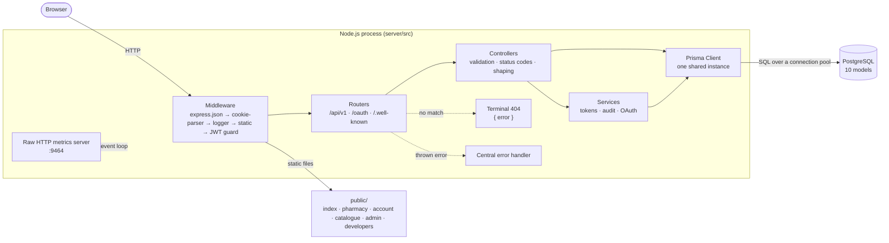
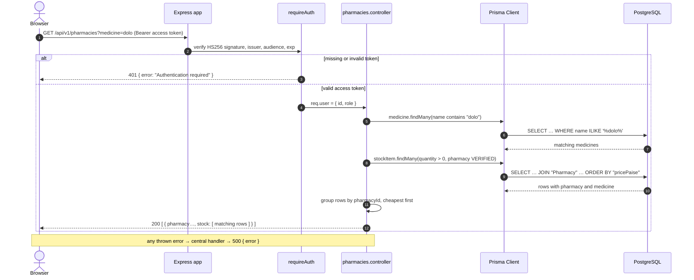
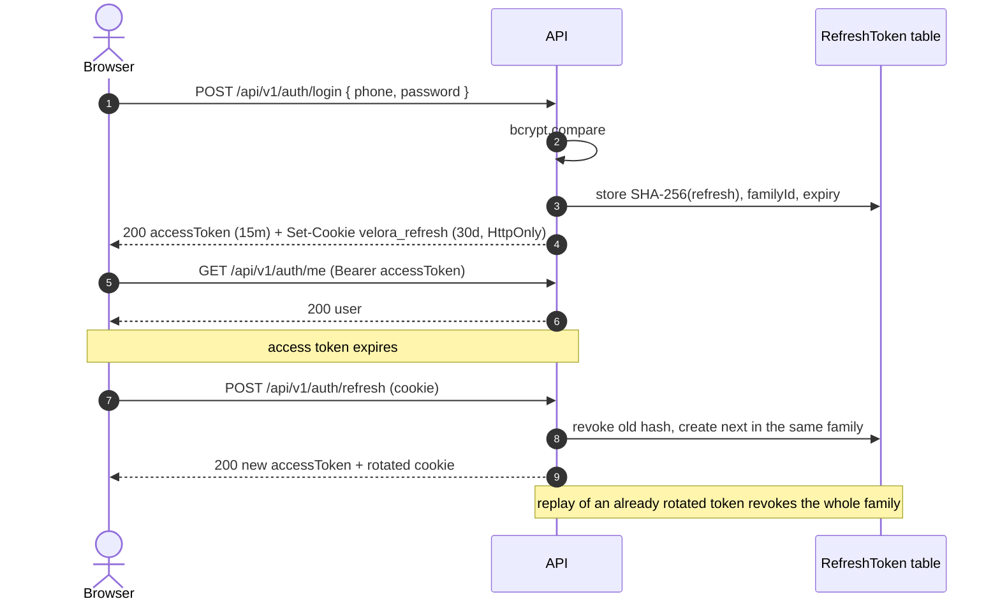
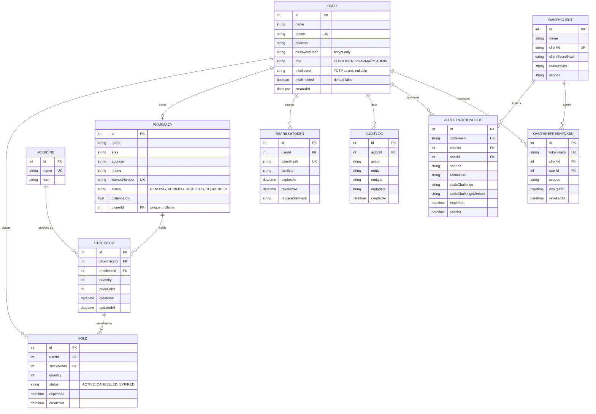

<div align="center">

# Velora

**Emergency medicine discovery: find a verified pharmacy that has your medicine in stock, right now.**


[Overview](#overview) · [Architecture](#architecture) · [Data model](#data-model) · [API reference](#api-reference) · [Getting started](#getting-started) · [Engineering decisions](#engineering-decisions)

</div>

---

## Overview

When someone needs a medicine urgently, typically late at night, in an unfamiliar area or for a prescription that is hard to find, the usual approach is to phone or visit pharmacies one at a time. Velora replaces that with one search: type a medicine name and get back only **verified** pharmacies that currently hold it **with stock above zero**, each listed with the matching items, quantities, prices and a sample distance.

Velora is the CSA213 Advanced Programming capstone at Rishihood University. It is a REST API built with **Node.js, Express 5, Prisma ORM and PostgreSQL**, plus a static client served by the same process.

The product has three audiences:

- **Customers** search live stock, reserve it for 30 minutes and manage their holds.
- **Pharmacy owners** register one pharmacy, maintain the shared medicine catalogue and keep their own shelf count current.
- **Administrators** review pharmacy licences, suspend or reject a pharmacy, read the audit trail and register OAuth clients for partner integrations.

Authentication is **stateless at the request boundary**: a short-lived JWT access token travels in the `Authorization: Bearer` header, while a rotating refresh token lives in an HttpOnly cookie and is stored only as a hash. Authorization is a **role-based** permission map (`CUSTOMER`, `PHARMACY`, `ADMIN`) narrowed by **attribute-based** ownership checks. Partner applications use the built-in **OAuth 2.0 authorization server and OpenID Connect provider**.

| Capability | Status |
| --- | --- |
| Express API skeleton: JSON parser, request logger, health check, terminal JSON 404 | Done |
| Fail-fast environment configuration | Done |
| Versioned API (`/api/v1`) with legacy aliases | Done |
| Relational schema and versioned Prisma migrations | Done |
| Idempotent development seed using `upsert` and `createMany` | Done |
| Medicines resource: list, filter, detail, owner-only writes | Done |
| Pharmacies resource: medicine search, area filter, detail with nested stock | Done |
| Stock resource: list by pharmacy, add, update, delete | Done |
| JWT access tokens, rotating refresh tokens, revocation and replay detection | Done |
| TOTP multi-factor authentication with authenticator apps | Done |
| Role-based access control with a permission map | Done |
| Attribute-based ownership checks for holds and pharmacy stock | Done |
| Admin console: licence approval, users, audit trail, runtime panel | Done |
| OAuth 2.0 authorization server with code + PKCE, client credentials and refresh grants | Done |
| OpenID Connect discovery, JWKS, RS256 ID tokens and UserInfo | Done |
| Audit trail persisted through an `EventEmitter` listener | Done |
| Streamed CSV export and `createMany` bulk stock import | Done |
| Offset pagination with `skip`/`take` and total counts | Done |
| Prometheus metrics and runtime snapshot on a separate raw HTTP server | Done |
| Central error handler with `AppError` and `asyncHandler` | Done |
| Responsive client with customer, pharmacy, admin and OAuth playground pages | Done |

---

## Architecture

Velora is a single Node.js process using a layered **router → controller → service → ORM** design. Controllers own HTTP concerns, services own token, audit and OAuth rules, and Prisma is the only database client.



### Middleware order

| # | Stage | Responsibility |
| --- | --- | --- |
| 1 | `express.json()` | Parses JSON request bodies into `req.body` |
| 2 | `express.urlencoded()` | Parses the OAuth consent and token forms |
| 3 | `cookie-parser` | Reads the HttpOnly refresh cookie |
| 4 | `logger` | Prints one line per request: `METHOD url` |
| 5 | Security headers | `X-Content-Type-Options`, `Referrer-Policy` |
| 6 | `express.static('public')` | Serves the client; non-file paths fall through |
| 7 | `/api/v1/*`, `/oauth`, `/.well-known` | Versioned API, OAuth server and discovery |
| 8 | Terminal 404 | Sends `{ "error": "Route not found" }` and never calls `next()` |
| 9 | Central error handler | Maps `AppError` and unexpected failures to the JSON contract |

### Request lifecycle: authenticated medicine search



### Token lifecycle



---

## Data model

Ten models. `StockItem` resolves the many-to-many relation between pharmacies and medicines and carries quantity and price. `Hold` reserves part of one stock row for 30 minutes. `RefreshToken`, `AuditLog` and the three OAuth models support identity and operations.



### Relational integrity rules

| Rule | Where it is enforced |
| --- | --- |
| Medicine names are unique | `@unique`; checked first in JavaScript so a duplicate returns `400` |
| Licence numbers are unique | `@unique`; checked first in JavaScript |
| One stock row per pharmacy–medicine pair | `@@unique([pharmacyId, medicineId])` |
| A stock row must reference real parents | Foreign keys with `ON DELETE RESTRICT ON UPDATE CASCADE` |
| A stocked medicine cannot be deleted | Checked in JavaScript before the foreign key would raise |
| Money never uses floating point | Integer **paise**; the client formats `₹` |
| One account per mobile number | `User.phone` is `@unique`; only a bcrypt hash is stored |
| One pharmacy per owner | `Pharmacy.ownerId` is `@unique` and nullable |
| Roles drive permissions | `User.role` is `CUSTOMER`, `PHARMACY` or `ADMIN`; the permission map is server-side |
| Ownership narrows a role | Hold cancellation and stock writes compare the record's `userId`/`ownerId` with the session |
| Refresh tokens are never stored raw | Only SHA-256 hashes; the raw value is the HttpOnly cookie |
| Refresh rotation is one-time | The old hash is revoked and linked to its replacement; replay revokes the family |
| Holds never overdraw stock | `$transaction` + `updateMany` checks `quantity >= requested` |
| Expired stock returns once | Due holds are marked `EXPIRED` and incremented in one transaction |
| OAuth codes are one-time | `usedAt` is set inside an `updateMany` guard |
| OAuth secrets are hashed | `clientSecretHash` uses bcrypt; the raw secret is shown once |
| Every sensitive action is audited | The `EventEmitter` listener persists `AuditLog` rows |

The schema lives in [`server/prisma/schema.prisma`](server/prisma/schema.prisma). Every migration is committed under [`server/prisma/migrations/`](server/prisma/migrations/).

---

## API reference

**Base URL:** `http://localhost:3000/api/v1` — the legacy unversioned paths remain as aliases.

### Authentication

Send the access token on every protected request:

```http
Authorization: Bearer <accessToken>
```

Access tokens are HS256 JWTs (`sub`, `role`, `type=access`, `iss`, `aud`, `exp`) valid for 15 minutes. The refresh token is an opaque 48-byte value in the `velora_refresh` HttpOnly cookie, valid for 30 days and rotated on every refresh. Accounts that enable TOTP multi-factor authentication must supply a six-digit authenticator code with the password at login.

### Response contract

| Outcome | Status | Body |
| --- | --- | --- |
| Read succeeded | `200` | The bare resource or a `{ data, pagination }` envelope |
| Resource created | `201` | The created row |
| Resource deleted | `204` | Empty |
| Invalid input | `400` | `{ "error": "…" }` |
| Missing or invalid access token | `401` | `{ "error": "Authentication required" }` |
| Role or ownership refused | `403` | `{ "error": "Insufficient permissions" }` or a specific ownership message |
| Unknown id or route | `404` | `{ "error": "…" }` |
| Unexpected failure | `500` | `{ "error": "Internal server error" }`, never a stack trace |
| OAuth token errors | `400` / `401` | `{ "error": "invalid_grant" }`, `{ "error": "invalid_client" }` |

### Endpoints

| Method | Path | Description | Codes |
| --- | --- | --- | --- |
| `GET` | `/health` | Liveness probe | 200 |
| `POST` | `/auth/register` | `{ name, phone, address, password, role }` → user + access token | 201, 400 |
| `POST` | `/auth/login` | `{ phone, password }` → user + access token | 200, 401 |
| `POST` | `/auth/refresh` | Rotate the refresh cookie, issue a new access token | 200, 401 |
| `POST` | `/auth/logout` | Revoke the presented refresh token | 204 |
| `GET` | `/auth/me` | Current account | 200, 401 |
| `PUT` | `/auth/me` | Update name, mobile and address | 200, 400, 401 |
| `PUT` | `/auth/password` | Change password and revoke every refresh token | 204, 400, 401 |
| `POST` | `/auth/mfa/setup` | Generate a TOTP secret and provisioning URI | 200, 401 |
| `POST` | `/auth/mfa/enable` | Verify a six-digit code and enable MFA | 200, 400, 401 |
| `POST` | `/auth/mfa/disable` | Disable with the password and a current code | 204, 400, 401 |
| `POST` | `/auth/logout-all` | Revoke every refresh token for the account | 204, 401 |
| `GET` | `/medicines` | All medicines, sorted by name | 200 |
| `GET` | `/medicines?name=` | Case-insensitive substring filter | 200 |
| `GET` | `/medicines/:id` | One medicine | 200, 400, 404 |
| `POST` | `/medicines` | Create `{ name, form }` · owner/admin | 201, 400, 401, 403 |
| `PUT` | `/medicines/:id` | Replace name and form · owner/admin | 200, 400, 401, 403, 404 |
| `DELETE` | `/medicines/:id` | Delete; refused while stocked · owner/admin | 204, 400, 401, 403, 404 |
| `GET` | `/pharmacies` | Verified pharmacies with stock · session | 200, 401 |
| `GET` | `/pharmacies?area=` | Filter by area | 200, 401 |
| `GET` | `/pharmacies?medicine=` | Search: in-stock matching medicine | 200, 401 |
| `GET` | `/pharmacies/:id` | One verified pharmacy with all stock | 200, 400, 404 |
| `GET` | `/pharmacies/mine` | The pharmacy owned by the caller | 200, 401, 403, 404 |
| `POST` | `/pharmacies/mine` | Register one pharmacy | 201, 400, 401, 403 |
| `PUT` | `/pharmacies/mine` | Edit name, area, address and phone | 200, 400, 401, 403, 404 |
| `GET` | `/stock?pharmacyId=` | Stock for one verified pharmacy | 200, 400 |
| `POST` | `/stock` | Add stock to the caller's pharmacy | 201, 400, 401, 403, 404 |
| `PUT` | `/stock/:id` | Edit quantity and price on own stock | 200, 400, 401, 403, 404 |
| `DELETE` | `/stock/:id` | Delete own stock row | 204, 400, 401, 403, 404 |
| `GET` | `/holds` | Current user's holds | 200, 401 |
| `POST` | `/holds` | Reserve `{ stockItemId, quantity }` for 30 minutes | 201, 400, 401, 404 |
| `DELETE` | `/holds/:id` | Cancel an active hold and restore stock | 204, 400, 401, 403, 404 |
| `GET` | `/admin/overview` | Counts, next pending pharmacy, recent audit | 200, 401, 403 |
| `GET` | `/admin/pharmacies` | Paginated pharmacy list, `status` and `stock` filters | 200, 400, 401, 403 |
| `POST` | `/admin/pharmacies` | Create a pharmacy with nested stock rows | 201, 400, 401, 403 |
| `PATCH` | `/admin/pharmacies/:id` | Set `PENDING`, `VERIFIED`, `REJECTED` or `SUSPENDED` | 200, 400, 401, 403, 404 |
| `GET` | `/admin/users` | Paginated accounts | 200, 400, 401, 403 |
| `GET` | `/admin/audit` | Paginated audit trail | 200, 400, 401, 403 |
| `GET` | `/admin/runtime` | Event loop, memory and process snapshot | 200, 401, 403 |
| `POST` | `/admin/stock/bulk` | `createMany` stock import with duplicate skipping | 201, 400, 401, 403, 404 |
| `GET` | `/admin/export/stock.csv` | Streamed CSV export | 200, 401, 403 |
| `GET` | `/admin/oauth-clients` | Registered OAuth clients | 200, 401, 403 |
| `POST` | `/admin/oauth-clients` | Create a client; secret returned once | 201, 400, 401, 403 |

### OAuth 2.0 and OpenID Connect

| Method | Path | Description |
| --- | --- | --- |
| `GET` | `/oauth/authorize` | Consent screen; requires a signed-in Velora browser session |
| `POST` | `/oauth/authorize` | Approve or deny; issues a one-time code |
| `POST` | `/oauth/token` | `authorization_code` + PKCE, `refresh_token`, `client_credentials` |
| `GET` | `/oauth/userinfo` | OIDC claims for an access token with the `openid` scope |
| `GET` | `/oauth/jwks` | RSA public key used to verify ID tokens |
| `GET` | `/.well-known/openid-configuration` | Discovery document |

- Authorization codes live for 5 minutes and are single-use.
- PKCE supports `S256` (preferred) and `plain`.
- OAuth access tokens are HS256 JWTs with `client_id`, `scope` and `type=oauth`, valid for 30 minutes.
- OAuth refresh tokens rotate and live for 14 days.
- ID tokens are RS256 JWTs signed by the process key; the public half is published at `/oauth/jwks`.
- Scopes: `openid`, `profile`, `holds:read`, `stock:read`.

### Examples

<details>
<summary><code>POST /api/v1/auth/login</code> and an authenticated search</summary>

```bash
curl -c jar -X POST http://localhost:3000/api/v1/auth/login \
  -H 'Content-Type: application/json' \
  -d '{"phone":"9000000001","password":"password123"}'

# → { "user": {...}, "accessToken": "eyJ…", "tokenType": "Bearer", "expiresIn": 900 }
# → Set-Cookie: velora_refresh=…; HttpOnly; SameSite=Lax; Path=/

curl -b jar "http://localhost:3000/api/v1/pharmacies?medicine=dolo" \
  -H "Authorization: Bearer $ACCESS_TOKEN"
```

</details>

<details>
<summary><code>POST /api/v1/auth/refresh</code></summary>

```bash
curl -b jar -c jar -X POST http://localhost:3000/api/v1/auth/refresh
```

The old refresh hash is revoked, a new one is stored in the same family, and a new access token is returned.
</details>

<details>
<summary><code>POST /oauth/token</code> with client credentials</summary>

```bash
curl -u "$CLIENT_ID:$CLIENT_SECRET" \
  -X POST http://localhost:3000/oauth/token \
  -d 'grant_type=client_credentials' \
  -d 'scope=holds:read'
```

</details>

<details>
<summary><code>GET /oauth/userinfo</code></summary>

```bash
curl http://localhost:3000/oauth/userinfo \
  -H "Authorization: Bearer $OAUTH_ACCESS_TOKEN"
```

```json
{ "sub": "25", "name": "Asha", "phone_number": "9000000001", "role": "CUSTOMER" }
```
</details>

---

## Getting started

### Prerequisites

| Tool | Version |
| --- | --- |
| Node.js | 18 or newer (developed on 22 LTS) |
| npm | bundled with Node.js |
| PostgreSQL | 12 or newer, running locally |

### 1 · Install

```bash
git clone https://github.com/vishalkbladerunner-create/velora_AP_2026.git
cd velora_AP_2026/server
npm install
```

### 2 · Configure

There is no `dotenv`. The API reads `process.env` once at start-up, through `src/config/env.js`, and **fails fast** if `DATABASE_URL` or `JWT_SECRET` is missing. Prisma's CLI reads `server/.env`; the running server reads the shell.

```bash
cp .env.example .env
# set DATABASE_URL and a long random JWT_SECRET
set -a; source .env; set +a
```

| Variable | Required | Default | Used by |
| --- | --- | --- | --- |
| `DATABASE_URL` | yes | none | API config, Prisma |
| `JWT_SECRET` | yes | none | Access and consent tokens |
| `ACCESS_TOKEN_TTL` | no | `15m` | Access token lifetime |
| `REFRESH_TOKEN_DAYS` | no | `30` | Refresh token lifetime |
| `OAUTH_ISSUER` | no | `http://localhost:3000` | Discovery and ID token issuer |
| `PORT` | no | `3000` | API |
| `METRICS_PORT` | no | `9464` | Raw HTTP metrics server |
| `AUTO_VERIFY_PHARMACIES` | no | `true` | Development auto-verification; set `false` to require admin approval |
| `NODE_ENV` | no | `development` | Disables catalogue writes in production |

### 3 · Create the schema and seed it

```bash
npx prisma migrate deploy
node prisma/dev-seed.js         # 18 medicines, 6 pharmacies, 31 stock rows
```

The seed uses `upsert` for medicines and pharmacies and `createMany({ skipDuplicates: true })` for stock, so a second run changes nothing.

### 4 · Run

```bash
npm run dev                     # nodemon
npm start                       # plain node
```

Open **http://localhost:3000**. The API and OAuth server share the port; metrics are on **http://localhost:9464/metrics**.

Create an administrator when you need the operations console:

```bash
node scripts/create-admin.js 9000000000 "Velora Admin" "Admin@2026!"
```

Then open `/admin.html` while signed in as that account.

---

## Roles and access control

| Role | Can do |
| --- | --- |
| `CUSTOMER` | Search stock, reserve and cancel holds, edit their profile |
| `PHARMACY` | Everything a customer can do, plus maintain medicines, register one pharmacy and edit only its stock |
| `ADMIN` | Everything, plus verify/suspend pharmacies, read the audit trail and manage OAuth clients |

The permission map lives in [`server/src/auth/permissions.js`](server/src/auth/permissions.js); ownership policies live in [`server/src/auth/policies.js`](server/src/auth/policies.js). A hidden navigation link is presentation only — the API returns `403` on its own.

New pharmacies start as `PENDING`. In development `AUTO_VERIFY_PHARMACIES` short-circuits the wait so the owner can add stock immediately; set it to `false` to exercise the full approval queue in `/admin.html`.

---

## Operations

- **Audit trail.** Domain events (`auth.login`, `hold.create`, `stock.update`, `admin.pharmacy_status`, `oauth.token`, …) are emitted on an `EventEmitter` and persisted by a listener in [`server/src/services/audit.service.js`](server/src/services/audit.service.js). The admin console reads them with pagination.
- **CSV export.** `GET /api/v1/admin/export/stock.csv` builds a `Readable` stream and pipes it to the response, so a large catalogue is not buffered in memory.
- **Metrics.** A separate `http.createServer` on port 9464 exposes Prometheus text at `/metrics`, a JSON snapshot at `/runtime` and a plain `/health`. The snapshot includes event-loop delay percentiles (`perf_hooks.monitorEventLoopDelay`), RSS/heap usage, V8 heap limit, CPU time, load average and uptime.
- **OAuth playground.** `/developers.html` runs the authorization code flow with PKCE in the browser and prints the access token, ID token, refresh token and UserInfo claims. Register `http://localhost:3000/developers.html` as a redirect URI in the admin console first.

---

## Project structure

```text
.
├── docs/                      API checks, report and design pages
├── server/
│   ├── prisma/
│   │   ├── schema.prisma      Ten models, source of truth
│   │   ├── migrations/        Versioned SQL, committed
│   │   ├── data/              Seed fixtures (JSON)
│   │   └── dev-seed.js        Upsert + createMany seed
│   ├── scripts/
│   │   └── create-admin.js    Bootstrap an administrator
│   ├── public/                Static client
│   │   ├── index.html         Search and results
│   │   ├── pharmacy.html      Stock detail and reservation
│   │   ├── account.html       Signup, profile, pharmacy, holds, security
│   │   ├── catalogue.html     Pharmacy workspace
│   │   ├── admin.html         Operations console
│   │   ├── developers.html    OAuth/OIDC playground
│   │   └── ui.js              Token-aware fetch, toasts, formatting
│   └── src/
│       ├── auth/              Permission map and ownership policies
│       ├── config/env.js      Read the environment once, fail fast
│       ├── db/prisma.js       One shared PrismaClient
│       ├── middlewares/       Auth, error handler, logger
│       ├── routes/            One router per resource
│       ├── controllers/       Validation, Prisma calls, status codes
│       ├── services/          Token, audit and OAuth rules
│       ├── runtime/metrics.js Raw HTTP metrics server
│       ├── utils/             AppError, asyncHandler, pagination
│       ├── app.js             Middleware order and mounting
│       └── server.js          Listen, start metrics, clean expired tokens
└── README.md
```

---

## Engineering decisions

| Decision | Rationale |
| --- | --- |
| **JWT access tokens + rotating refresh tokens** | Requests stay stateless and cheap to verify, while revocation and replay detection remain possible on the refresh path. |
| **Refresh token stored as SHA-256, cookie as HttpOnly** | A database leak does not expose usable tokens; JavaScript cannot read the cookie. |
| **Rotation with family replay detection** | A stolen refresh token cannot be reused after rotation without revoking the legitimate family. |
| **RBAC + ABAC** | Roles answer “what kind of account is this”; ownership answers “may this account touch this record”. |
| **Built-in OAuth 2.0 / OIDC provider** | Partner integrations get scoped, revocable access without sharing a user password; the same JWT and Prisma primitives are reused. |
| **RS256 ID tokens, HS256 API tokens** | Relying parties verify identity with the public JWKS; first-party API verification stays symmetric and fast. |
| **One shared `PrismaClient`** | Every module imports `src/db/prisma.js`, so the process holds a single connection pool. |
| **Integer paise for money** | Avoids floating-point rounding; formatting happens only at the edge. |
| **Server-owned status and role** | Neither can be set from a public request body; the admin route changes status, registration fixes the role. |
| **Audit through an `EventEmitter`** | The request path does not wait for the audit insert; listeners can be added without touching controllers. |
| **Streamed CSV** | `pipeline(Readable, res)` respects backpressure instead of buffering the whole stock table. |
| **Raw HTTP metrics server** | Scrapers get a tiny, dependency-free endpoint; the process and event-loop stats come from Node itself. |
| **Offset pagination with totals** | `skip`/`take` plus `count` in one transaction gives the admin tables a stable page model. |
| **Central error handler** | Controllers throw `AppError`; one middleware owns the envelope and hides stack traces. |
| **Fail-fast configuration** | A misconfigured environment stops at boot with one clear message. |

---

## Verification

Every endpoint is exercised with `curl` against a seeded database, and the results are recorded in [`docs/api-checks.md`](docs/api-checks.md) as *request → expected → actual*.

| Suite | Owner | Covers | Result |
| --- | --- | --- | --- |
| t1 · Medicines read | Manav | list, filter, 400 / 404, create / replace / delete | 10 / 10 pass |
| t2 · Pharmacies read | Manav | verified-only list and detail, area, medicine search, server-owned status, array query | 13 / 13 pass |
| t3 · Stock read | Sayem | list by pharmacy, 400 validation, PENDING exclusion | 3 / 3 pass |
| t4 · Envelope and codes | Sayem | status codes, error envelope, terminal 404, bracket query | 8 / 8 pass |
| t7 · Accounts | Vishal | register, duplicate, login, bad password, me, logout, password hash | 9 / 9 pass |
| t8 · Holds | Vishal | reserve, list, cross-user 403, cancel, insufficient stock, PENDING stock, expiry restore | 10 / 10 pass |
| t9 · Pharmacy ownership | Vishal | register mine, duplicate 400, own stock 201, other pharmacy 403, other user 403, anon 401 | 12 / 12 pass |
| t10 · Catalogue page | Vishal | signup with pharmacy, own stock, search hit | 4 / 4 pass |
| t11 · Account types & editing | Vishal | customer vs pharmacy signup, role 403s, profile, pharmacy, medicine and stock edits, address and distance | 12 / 12 pass |
| t12 · JWT, refresh rotation, RBAC | Vishal | login, Bearer access, refresh rotation, logout revocation, role 403s, password change | 12 / 12 pass |
| t13 · Admin and audit | Vishal | overview, pending queue, approval, users, paginated audit, CSV stream, bulk createMany | 10 / 10 pass |
| t14 · OAuth 2.0 / OIDC | Vishal | client credentials, code + PKCE, ID token RS256, JWKS, UserInfo, refresh grant, discovery | 11 / 11 pass |
| t15 · TOTP MFA | Vishal | setup secret, enable, login challenge, valid and invalid codes, disable, browser prompt | 8 / 8 pass |

---

## Scope and non-goals

Everything above is implemented in this repository. Still out of scope:

- **External identity providers.** Velora is the OAuth/OIDC provider; it does not yet federate Google, GitHub or Apple sign-in.
- **Email/SMS and payments.** No notification or payment integration.
- **GPS and maps.** The distance shown on a result is a seeded `distanceKm` value stored on each pharmacy, not a geolocation calculation.
- **Admin licence documents.** The admin workflow changes status; it does not store uploaded licence files.
- **Production hardening.** The refresh cookie is `Secure` in production, but the build still runs on HTTP locally. The OIDC RSA key is generated at boot and therefore rotates on restart.

---

## Team and workflow

| Member | Ownership |
| --- | --- |
| **Vishal** | Toolchain, Express skeleton, configuration, static client, README, JWT/OAuth/RBAC, admin console, operations |
| **Manav** | Prisma schema and migrations, development seed, Medicines and Pharmacies APIs |
| **Yash** | Error utilities and demo presentation |
| **Sayem** | Stock API, client wiring, contract sweep and report |

- **Branches:** `feat/<n>-<slug>`, `chore/<n>-<slug>`, `docs/<n>-<slug>`.
- **Commit format:** a conventional subject, then lecture tags, files and phase.
- **Review:** every commit is read by a ring partner before it is merged.

---

<div align="center">
<sub>CSA213 Advanced Programming · Rishihood University · 2026</sub>
</div>
